# SkillBridge

AI-powered internship matching platform. Students create a profile with skills and a resume, recruiters post roles, and each student is shown jobs ranked by how well their skills match.

## Features

- Student and recruiter sign-up and login
- Student profile with skills, interests, CGPA and PDF resume upload
- Job listings sorted by match percentage
- Application tracking for students
- Recruiter dashboard with ranked candidates and status updates (Applied, Shortlisted, Selected, Rejected)

## Tech stack

- Frontend: React, Vite, Tailwind CSS
- Backend: Node.js, Express
- Database: PostgreSQL
- Matching: Gemini API

## Run locally

Requirements: Node.js 18 or newer, PostgreSQL, Git.

1. Clone the repo

```bash
git clone https://github.com/nitingiri911/skillbridge.git
cd skillbridge
```

2. Create the database and load the schema

```bash
psql -U postgres -c "CREATE DATABASE skillbridge;"
psql -U postgres -d skillbridge -f database/schema.sql
```

3. Start the backend

```bash
cd backend
npm install
copy .env.example .env
npm run dev
```

On macOS or Linux use `cp .env.example .env`. Open `.env` and set `DB_PASSWORD` and `JWT_SECRET`. Add `GEMINI_API_KEY` for AI matching, and the AWS keys and `S3_BUCKET_NAME` only if you want resume uploads to work. The backend runs on `http://localhost:5000` and `GET /health` checks that it is up.

4. Start the frontend in a second terminal

```bash
cd frontend
npm install
npm run dev
```

Open `http://localhost:3000`. The frontend calls `http://localhost:5000/api` by default.

## AWS deployment (ap-south-1, Mumbai)

Built and running as a proof of concept:

- EC2 (t3.micro): backend
- RDS PostgreSQL (db.t4g.micro, single-AZ): database
- S3: frontend static website and resume storage
- IAM user and AWS managed KMS key for RDS

## Disaster recovery case study

The case study topic is **Designing a Disaster Recovery Architecture on AWS: A Multi-Region Backup and Recovery Strategy**.

The warm standby in ap-southeast-1 (Singapore) is a design only and is not deployed, because a live multi-region setup costs about $100 per month.

- `dr/skillbridge-dr-stack.yaml`: CloudFormation template for the designed Singapore standby (ALB, Auto Scaling group, cross-region RDS read replica, replica S3 buckets, Route 53 failover)
- Design targets: RTO of 15 minutes or less, RPO of 5 minutes or less (not measured)
- The one real recovery in the prototype: the RDS instance was restored with point-in-time recovery, with no data lost

## Screenshots

Application:

| | |
|---|---|
| 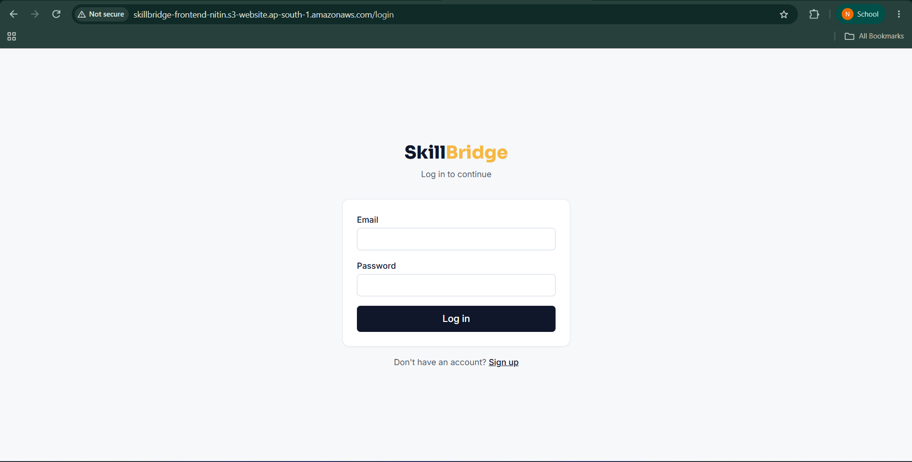 Login | 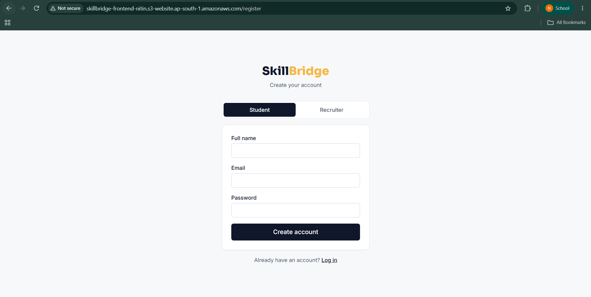 Student sign-up |
| 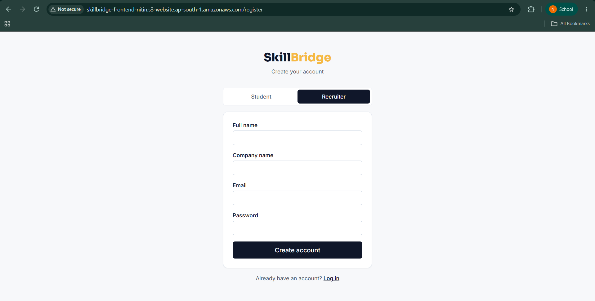 Recruiter sign-up | 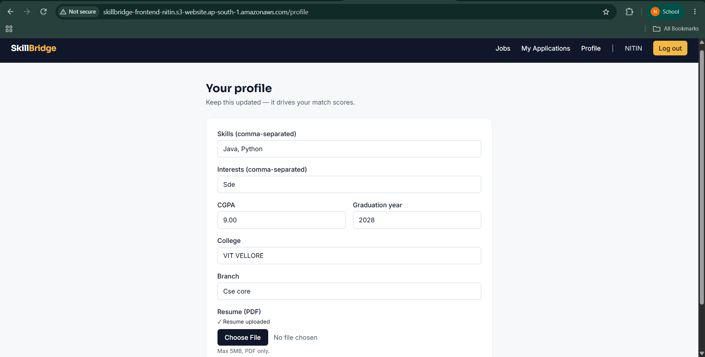 Student profile |
| 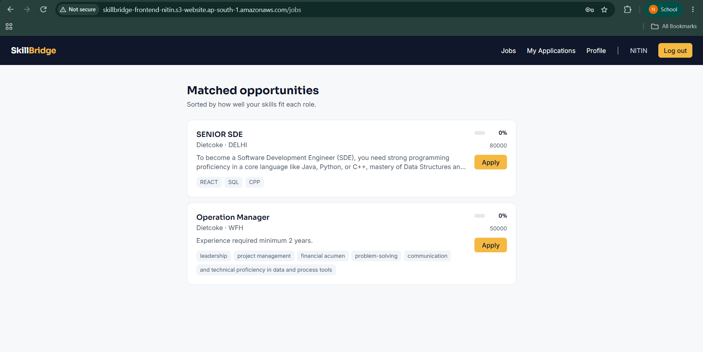 Matched jobs | 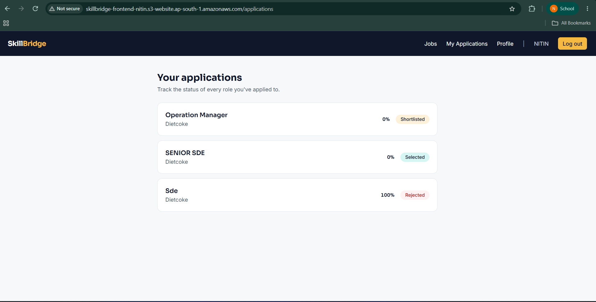 My applications |
| 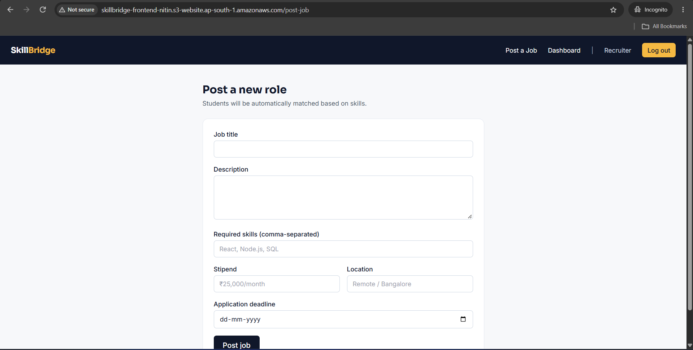 Recruiter posts a job | 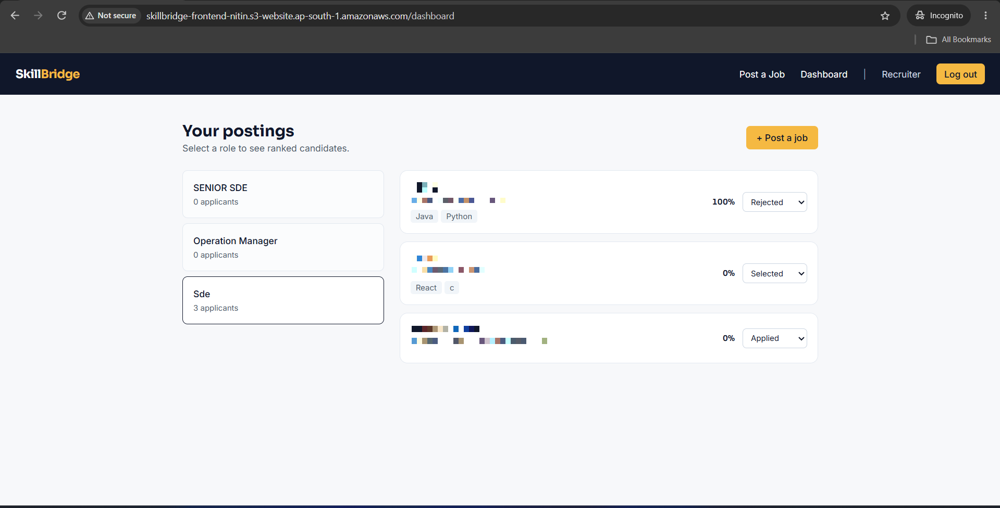 Recruiter dashboard |

AWS console:

| | |
|---|---|
| 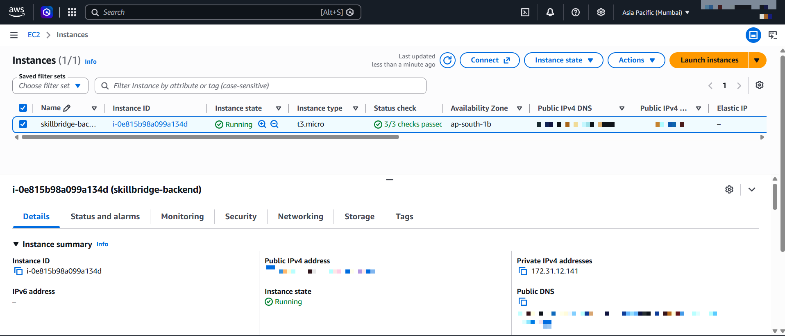 EC2 backend instance | 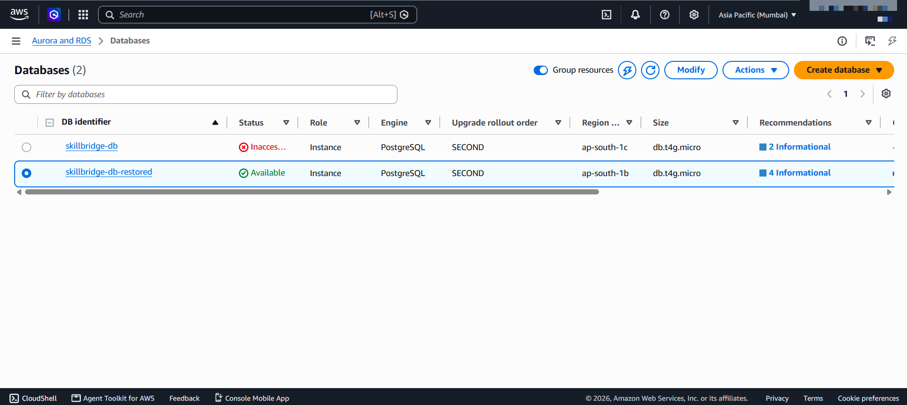 RDS databases |
| 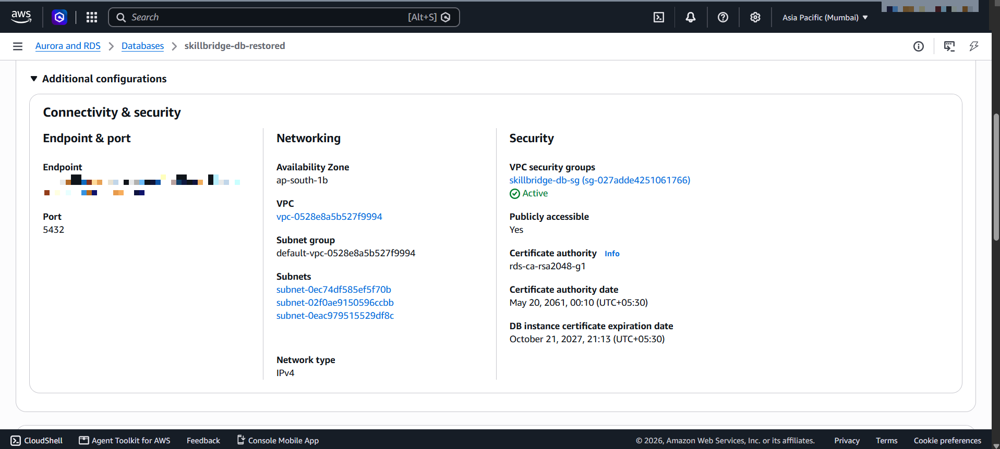 RDS connectivity | 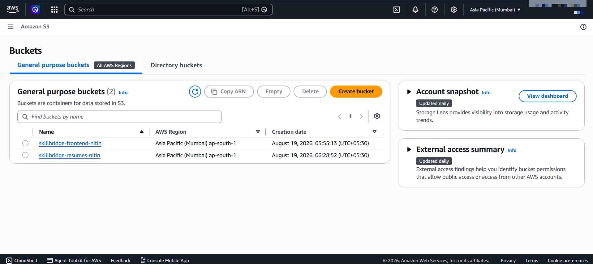 S3 buckets |
| 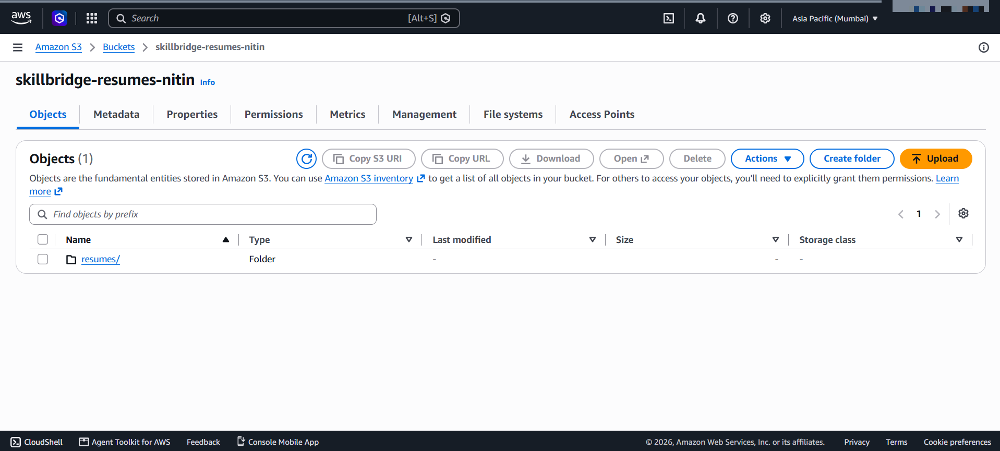 Resume bucket | 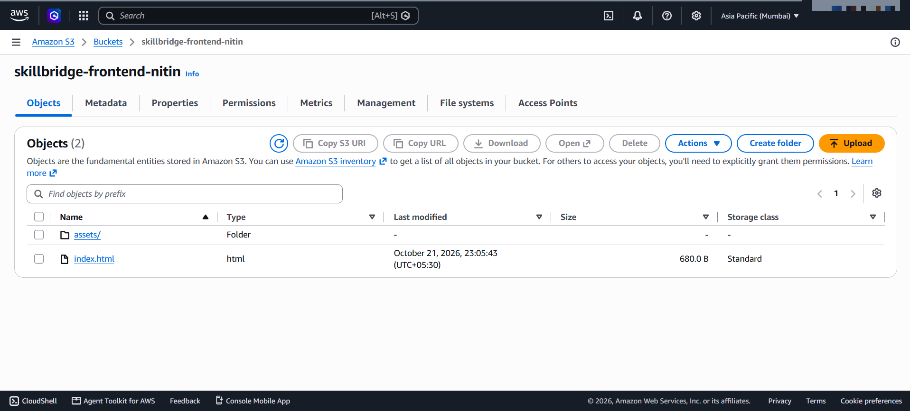 Frontend bucket |
| 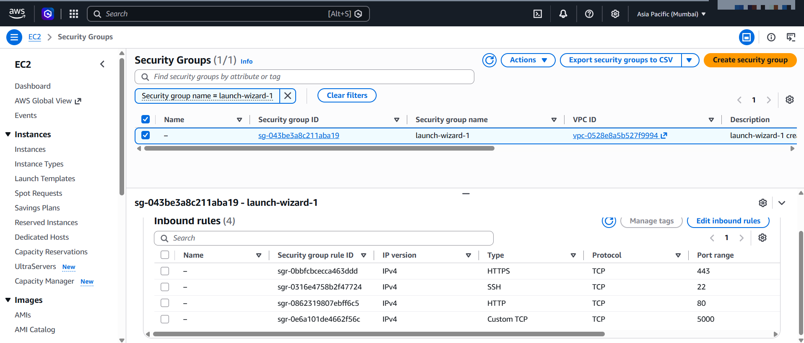 Security group | 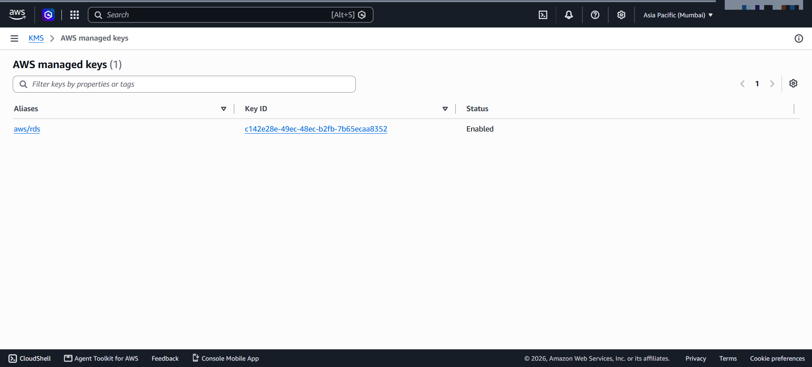 KMS managed key |
| 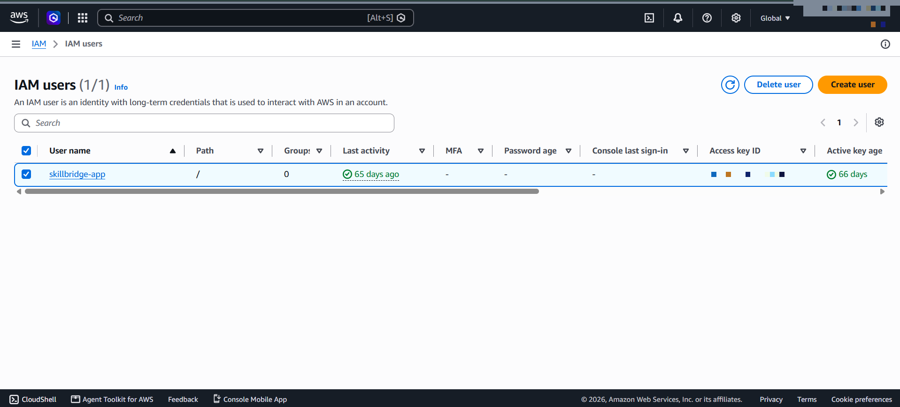 IAM user | |

## Student details

| Field | Details |
|---|---|
| Name | NITIN |
| Registration number | 24BCE2132 |
| Course | BCSE355L |
| Faculty | Dr. Saranya P |
| College | VIT Vellore |
